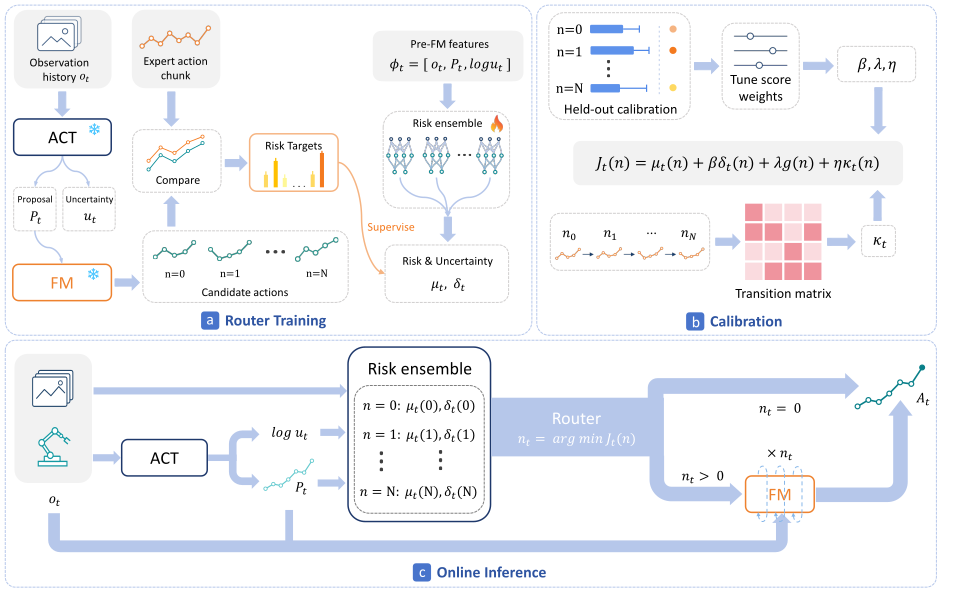

<h1 align="center">RAIN: Refine Actions If Needed</h1>
<h3 align="center">Adaptive Action Chunk Refinement for Robot Manipulation</h3>

<p align="center">
Hanlin Liu · Zichen Zhou · Jiacheng Zhang · Liuyuan Na · Jin Jin<br>
Guangyan Chen · Yufeng Yue · Gen Li · Fangqiang Ding
</p>

<p align="center">
<a href="https://rain-policy.github.io/">Project page</a> ·
arXiv: coming soon ·
<a href="https://github.com/rain-policy/RAIN/releases/tag/v0.1.0">Pretrained models</a> ·
<a href="docs/README.md">Documentation</a>
</p>

<p align="center">
<a href="https://github.com/rain-policy/RAIN/actions/workflows/checks.yml"></a>
</p>

RAIN starts with an action chunk proposed by ACT, chooses how much to improve it,
and runs the selected flow-matching steps before execution. This repository
provides **training and pretrained evaluation for eight ManiSkill tasks** using
state observations. Each decision executes eight actions and selects zero to
three refinement steps.



## Start here

| I want to… | Guide |
|---|---|
| Install the reference environment | [Installation](docs/installation.md) |
| Download and verify pretrained models | [Models](docs/models.md) |
| Run RAIN and inspect evaluation results | [Evaluation](docs/evaluation.md) |
| Prepare demonstration data | [Data](docs/data.md) |
| Train and calibrate RAIN | [Training](docs/training.md) |
| Understand the implementation | [Codebase guide](docs/codebase.md) |
| Resolve an installation or runtime issue | [Troubleshooting](docs/troubleshooting.md) |

## Quick start

Use **Linux, Python 3.10 and an NVIDIA GPU**. Install the pinned dependencies
and configure Vulkan following the [installation guide](docs/installation.md).
Run all commands below from the repository root.

```bash
# Access the current private model release through GitHub CLI.
gh auth login
python tools/download_models.py --task pickcube
python run.py --task pickcube --verify-only

# Run one complete evaluation episode.
CUDA_VISIBLE_DEVICES=0 python run.py \
  --task pickcube --episodes 1 --output outputs/pickcube-smoke
```

To evaluate all released models:

```bash
python tools/download_models.py
python run.py --task all --verify-only
CUDA_VISIBLE_DEVICES=0 python run.py \
  --task all --episodes 100 --output outputs/evaluation-100
```

Results are written to `outputs/evaluation-100/summary.json` and one
`results.json` per task. Use a new output directory for each run. See
[evaluation](docs/evaluation.md) for video output, seeds and result fields.

## Tasks and reference results

The table reports the archived **100-episode evaluation per task**. Deployment
uses the same H8 configuration for every refinement choice.

| Task argument | Environment | Control mode | Reference success |
|---|---|---|---:|
| `pickcube` | PickCube-v1 | `pd_ee_delta_pos` | 100% |
| `pushcube` | PushCube-v1 | `pd_ee_delta_pos` | 96% |
| `stackcube` | StackCube-v1 | `pd_ee_delta_pos` | 91% |
| `peginsertionside` | PegInsertionSide-v1 | `pd_ee_delta_pose` | 59% |
| `plugcharger` | PlugCharger-v1 | `pd_ee_delta_pose` | 11% |
| `pullcubetool` | PullCubeTool-v1 | `pd_ee_delta_pose` | 89% |
| `pusht` | PushT-v1 | `pd_ee_delta_pose` | 24% |
| `stackpyramid` | StackPyramid-v1 | `pd_ee_delta_pose` | 63% |
| **Average** | **800 episodes total** | | **66.625%** |

The packaged release has completed one integration episode per task, matching
the corresponding archived episodes. The full 800-episode evaluation and full
retraining were not repeated during packaging. Details are in the
[validation record](docs/validation.md).

## Training

Prepare a task-matched demonstration HDF5 file, then preview the nine-stage
training workflow:

```bash
python train.py --task pickcube --demo data/pickcube.h5 --output runs/pickcube
```

Add `--run` to execute the workflow. The [training guide](docs/training.md)
describes stage dependencies, model export paths and evaluation of a newly
trained policy. The [data guide](docs/data.md) defines the HDF5 schema and the
400/50/50 split.

## Repository layout

```text
RAIN/
├── run.py                   # Pretrained evaluation and model verification
├── train.py                 # Training and calibration orchestration
├── src/
│   ├── policies/            # Proposal, refiner and error-prediction ensemble
│   ├── data/                # Demonstration loading and trajectory splits
│   └── runtime/             # FP32 / CUDA Graph inference
├── scripts/                 # Stage implementations and rollout helpers
├── manifests/               # Task settings, data identities and model checksums
├── tools/                   # Verified model download and installation
├── docs/                    # User and developer guides
├── assets/                  # Method figure used by this README
├── tests/                   # CPU regression and release checks
└── .github/                 # CI, issue forms and pull-request template
```

Downloaded models, demonstrations, run outputs and caches are kept outside Git.
The [codebase guide](docs/codebase.md) maps method components to their source
files and explains the module identifiers retained for checkpoint compatibility.

## Project and citation

- **Project page:** [rain-policy.github.io](https://rain-policy.github.io/)
- **Paper / arXiv:** the public preprint link and paper BibTeX will be added here
  when available.
- **Software citation:** [CITATION.cff](CITATION.cff) records this repository's
  confirmed authors and software release metadata.
- **Updates:** [Changelog](CHANGELOG.md)

## Development and access

See [CONTRIBUTING.md](CONTRIBUTING.md) for local checks and issue reports.
The current code and model release are private; the public-use license is
pending. See [LICENSE](LICENSE) and [third-party notices](THIRD_PARTY_NOTICES.md).
